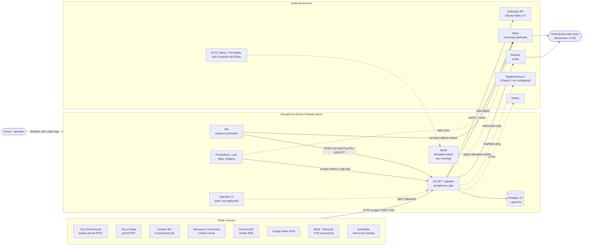

# 1. System Context

_As of 2026-10-16._

GroupScout watches public records around Richmond, BC (building permits, tenders, film productions, convention-centre events and news) for projects that will bring crews or delegates to town, and turns them into hotel group-sales leads.

**Reading it**

- Solid arrows are live paths. Dotted arrows are built but disabled, or planned.
- The only trigger in production is the n8n schedule. `/run` can also be called by hand with the API token. `/ingest` and `/n8n/webhook` accept single projects pushed from outside.
- Leads leave the system through Slack, with an email copy through Resend. Nothing is exposed outside the PC yet: ingress (Cloudflare Tunnel or Tailscale) is open decision D5 (`groupscout-site-6ah.17`).
