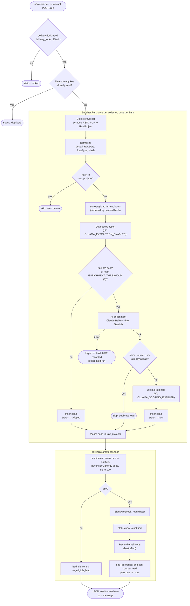
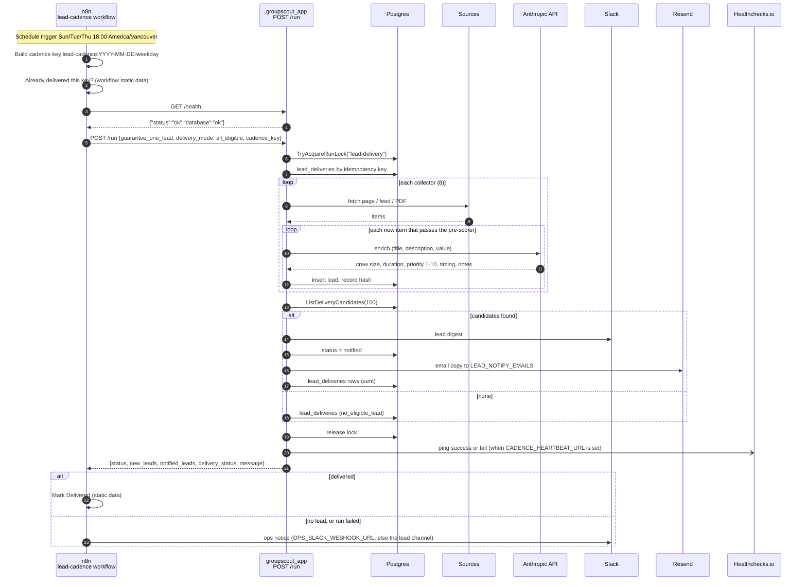
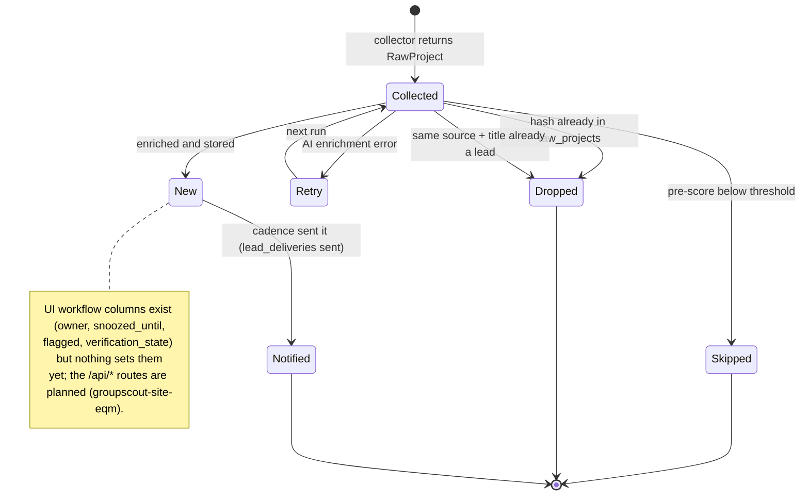

# 2. End-to-End Lead Flow

_As of 2026-10-16, backend image `9c69038`._

## 2.1 Pipeline stages

One `/run` walks every collector in order. Each collected item passes through the stages below; the code is `internal/enrichment/enricher.go` and `cmd/server/pipeline.go`.

**Notes**

- The pre-scorer (`internal/enrichment/scorer.go`) is a cheap gate in front of Claude. It scores title, location and description: +2 for Richmond/YVR and nearby places, +1/+2 for value over $1M/$10M, +1 per crew or event keyword, -5 for residential titles or stories outside B.C.
- Skipped items keep their hash, so a later scorer change does not revisit them (`groupscout-site-95y`).
- Delivery sends every eligible lead regardless of Claude's priority score (`groupscout-site-ea0`).
- `new_leads` in the result counts skipped leads too. Enrichment failures are not reported in the result (`groupscout-site-chd`).

## 2.2 Cadence run, step by step

## 2.3 Lead lifecycle

Production counts on 2026-10-16: 128 `skipped`, 19 `notified`, 0 `new`.
