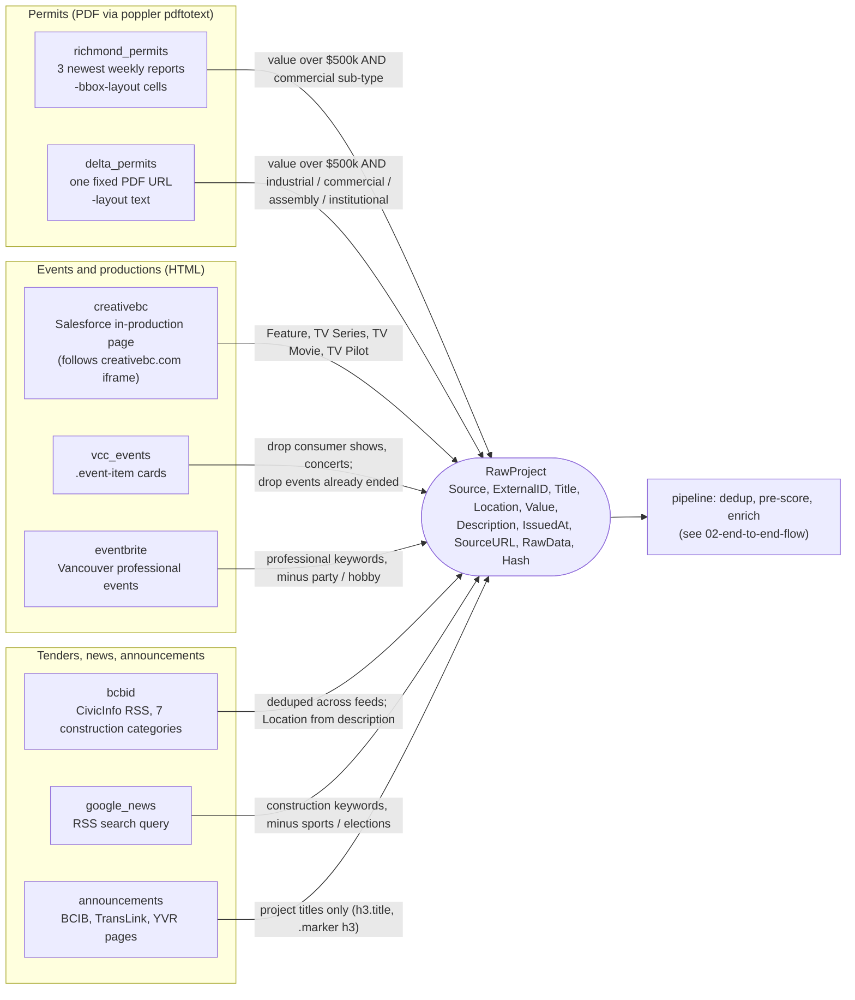

# 3. Collectors

_As of 2026-10-16. Counts are from the manual run at 04:17 UTC on image `9c69038`._

Every source implements `collector.Collector` (`Name()`, `Collect(ctx) ([]RawProject, error)`). `cmd/server/pipeline_build.go` builds the list from config; a collector error is logged and the run moves on to the next one.

| Collector | Source | Format and parser | Collector filter | Dedup hash | Last run |
|---|---|---|---|---|---|
| `richmond_permits` | richmond.ca weekly building reports | PDF, `pdftotext -bbox-layout`, cells classified by content and column position | value over `MIN_PERMIT_VALUE_CAD` (500k) and a commercial sub-type whitelist | folder number + address + issue date | 22/17/21 records parsed, 1 kept ($2M warehouse, 2471 Viking Way) |
| `delta_permits` | `DELTA_PERMITS_URL` (delta.ca/media/4784) | PDF, `pdftotext -layout` | value over 500k, type prefix industrial / commercial / assembly / institutional | permit number + address + date | 32 parsed, 2 kept, both seen; **URL is a frozen Mar 2–6 report** (`pkk`) |
| `creativebc` | creativebc.my.salesforce-sites.com/inproduction | HTML (`x/net/html`), `h5` category, `h3.production` title, labelled `<b>` fields | Feature, TV Series, TV Movie, TV Pilot | title + type | 25 parsed, 17 kept |
| `vcc_events` | vancouverconventioncentre.com/events | HTML (goquery), `.event-item` anchors | drop consumer shows, concerts and events that ended before today | title + date text | 9 kept |
| `bcbid` | civicinfo.bc.ca RSS, categories 5, 13, 33, 34, 42, 62, 69 | RSS (`encoding/xml`) | none (pre-scorer decides) | guid + title + link | 11 tenders |
| `google_news` | Google News RSS search (`NEWS_RSS_URL`) | RSS (gofeed) | construction keywords, minus sports and elections | guid or link | 15 items |
| `announcements` | bcib.ca/projects, TransLink projects, news.yvr.ca | HTML (goquery) | BCIB project cards and map markers; TransLink `h4`; YVR `h3` | source + title | 35 items, all seen |
| `eventbrite` | eventbrite.ca Vancouver professional-services listing | HTML (goquery) | professional keywords, minus party and hobby | link | 34 items, all seen |

Each collector is switched on by `*_ENABLED` and, where it has one, its URL by `*_URL` (see `config/config.go`). Richmond always runs; Delta runs when `DELTA_PERMITS_URL` is set.
