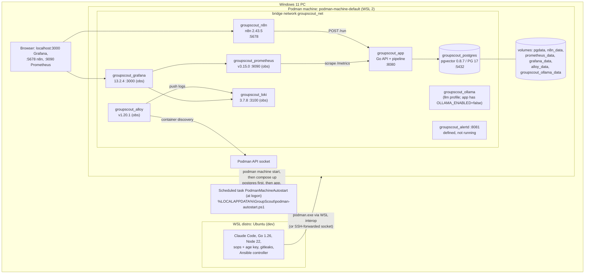
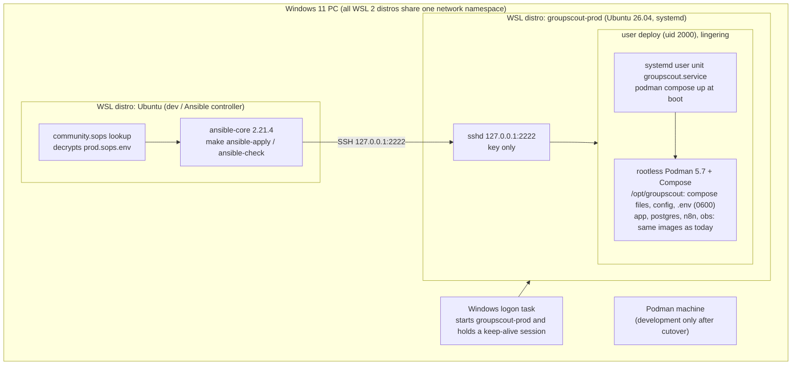

# 4. Runtime Topology

_As of 2026-10-16._

## 4.1 Today: the Podman machine on the home PC

The live stack runs in the Podman machine on the Windows PC. Compose project `groupscout`, working directory `C:\Users\alvin\GolandProjects\groupscout-iac` (branch `task/iac-phase9-monitoring`), files `docker-compose.yml` + `docker-compose.override.yml`, and `.env` rendered from `deploy/secrets/prod.sops.env`.

- Host ports come from `docker-compose.override.yml` and are published on the PC's localhost only. Nothing is reachable from outside the PC (ingress, decision D5, is open).
- The Podman machine does not start on boot by itself; the logon task starts it, waits for Postgres to be healthy, then starts the rest.
- Deploying today means building `groupscout:local` on the machine from the `groupscout-iac` worktree and recreating `groupscout_app` (see [07-iac.md](./07-iac.md#74-delivery-today-and-planned)).

## 4.2 Target: the `groupscout-prod` WSL host (Phase 5)

Built on PR #17 and running as staging. The cutover is `groupscout-site-6ah.18`.

Roles in `deploy/ansible/site.yml`: `base`, `hardening`, `podman`, `groupscout`. The host disables WSL interop and detaches `binfmt_misc` so stopping it cannot break the other distros, and uses uid 2000 because the Podman machine already owns uid 1000's cgroup.
