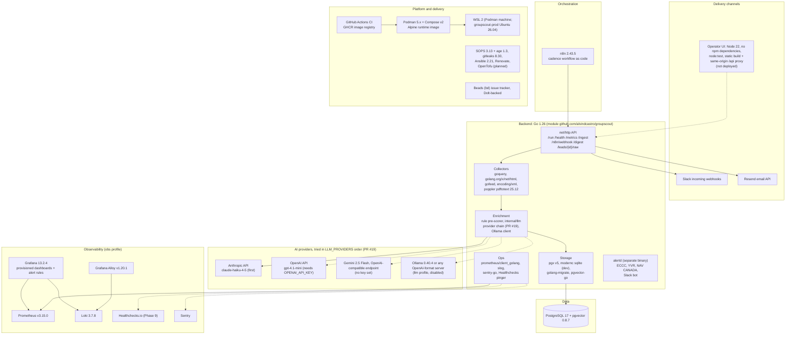

# 5. Tech Stack

_As of 2026-10-16. Versions are the pinned ones in `go.mod`, `docker-compose.yml`, the Dockerfiles and the CI workflow._

| Layer | Choice | Why it is there |
|---|---|---|
| Language | Go 1.26, one module, two binaries (`groupscout`, `alertd`) | Single static binary, small Alpine image |
| HTML / feeds | goquery, `x/net/html`, gofeed, `encoding/xml` | Every source is a public page, feed or PDF; no source has an API |
| PDFs | Poppler `pdftotext` (`-bbox-layout` for Richmond, `-layout` for Delta) | Correct font handling; word coordinates for table parsing |
| AI | Claude Haiku 4.5 today. PR #19 adds an ordered provider chain: Anthropic's Messages API plus one OpenAI-format adapter for OpenAI, Gemini, Ollama and others | Cheap structured enrichment; the rule pre-scorer limits calls; failover when one account is empty ([AI_PROVIDERS.md](../../backend/docs/guides/AI_PROVIDERS.md)) |
| Database | Postgres 17 + pgvector; SQLite for local dev | Dedup, audit trail, leads, delivery records, embeddings |
| Scheduling | n8n workflow imported from git at start | Retries and ops notices without new code (D11) |
| Notifications | Slack webhooks, Resend email | Where the sales team already works |
| Observability | Prometheus, Loki, Alloy, Grafana, Healthchecks.io, Sentry | Metrics, logs, alert rules, external dead man's switch |
| Runtime | Rootless Podman + Compose on WSL 2 | $0 home hosting; same Ansible moves to a VPS (D1, D4) |
| IaC | SOPS + age, Ansible, GitHub Actions, GHCR, Renovate; OpenTofu planned | See [07-iac.md](./07-iac.md) |
| Frontend | Dependency-free Node 22 UI with `node:test` | Same-origin operator workspace; waits on backend `/api/*` |
