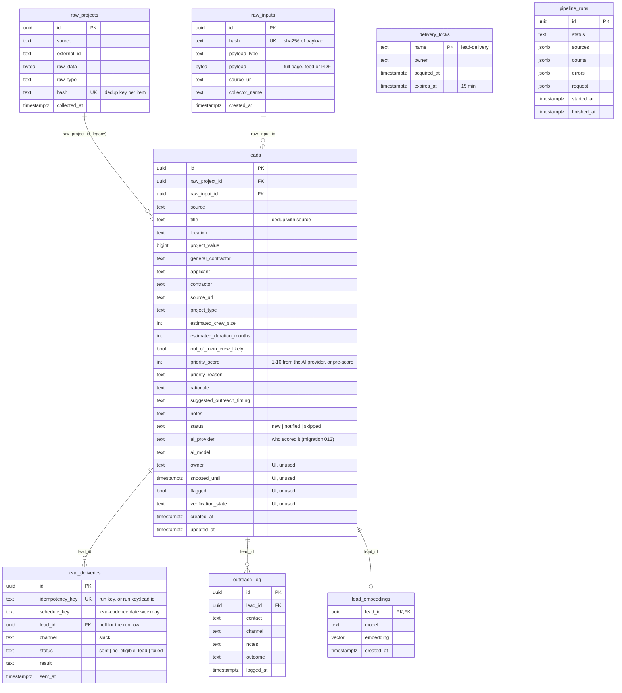
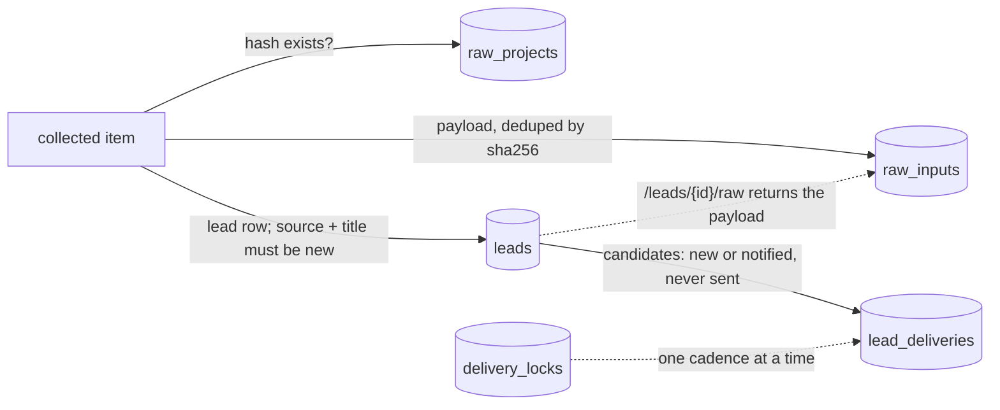

# 6. Data Model

_As of 2026-10-16: Postgres schema after migrations 001–011, read from the live database. Migration 012 (backend PR #19, not deployed) adds `leads.ai_provider` and `leads.ai_model`._

## How the tables are used

- `raw_projects.hash` is the "seen before" check. Since PR #18 it is written only after the item reaches a terminal state, so failed enrichments are retried.
- `raw_inputs` is the audit trail: one row per distinct payload. Feed and page collectors store the whole document, so many leads share one row.
- `lead_deliveries` makes cadence runs idempotent: one row per run key and one per delivered lead. A lead with a `sent` row is never offered again.

Row counts on 2026-10-16: `raw_projects` 169, `raw_inputs` 65, `leads` 147 (128 skipped, 19 notified), `lead_deliveries` 44; `outreach_log`, `lead_embeddings` and `pipeline_runs` are empty.
