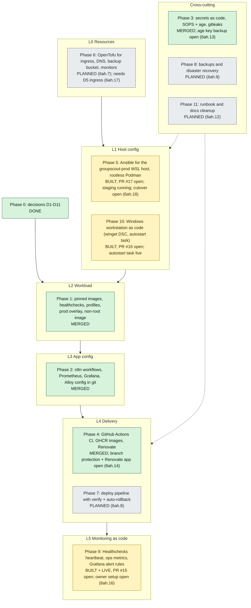
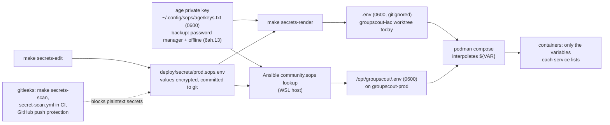
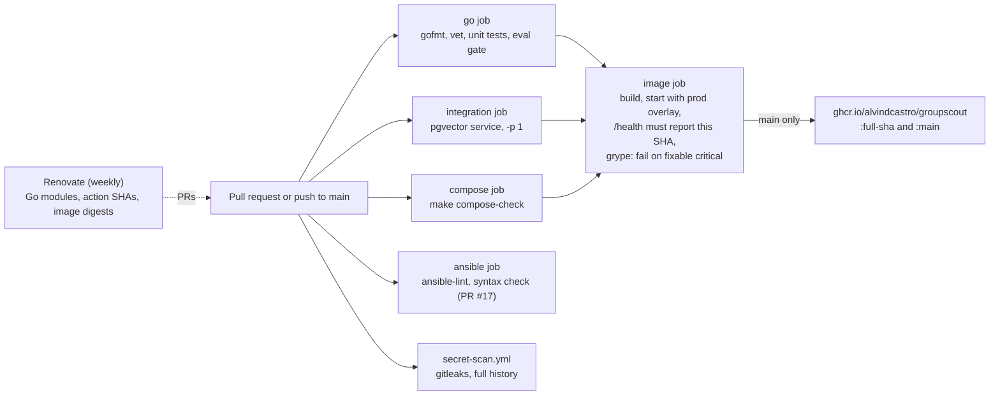
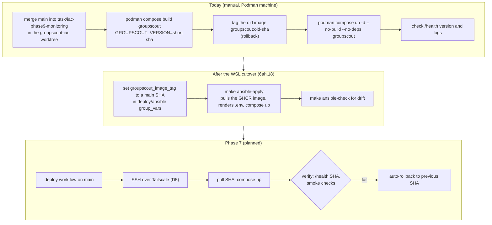

# 7. Infrastructure as Code

_As of 2026-10-16. The full plan is [INFRASTRUCTURE_AS_CODE.md](../../backend/docs/planning/INFRASTRUCTURE_AS_CODE.md); the epic is `groupscout-site-6ah`._

## 7.1 Layers and phase status

Green: merged to `main`. Yellow: built and in use, waiting on a PR or an owner step. Grey: planned.

Decisions that shape the diagram: D1 production on a dedicated WSL 2 distro; D2 OpenTofu; D3 Ansible; D4 rootless Podman + Compose; D5 ingress **open**; D6 no Coolify; D7 SOPS + age; D8 IaC lives in the backend repo's `deploy/`; D10 Ollama off in production; D11 keep n8n.

## 7.2 Secrets flow

## 7.3 CI and image publishing

The UI repo runs the same shape: `test` (`node:test`), then `image` to `ghcr.io/alvindcastro/groupscout-ui`, plus its own gitleaks scan.

## 7.4 Delivery: today and planned

The live image comes from `task/iac-phase9-monitoring`, not `main`, until PR #15 merges. Check the running container's `org.opencontainers.image.revision` label before deploying.
