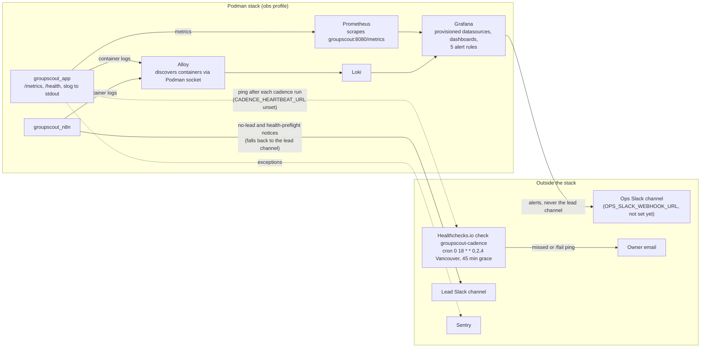
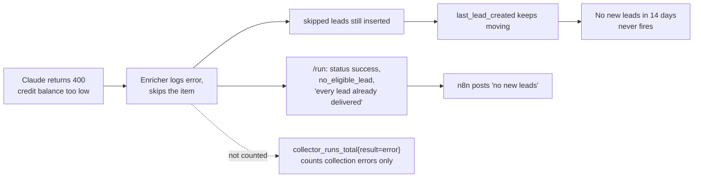

# 8. Observability

_As of 2026-10-16. Runbook: [MONITORING.md](../../backend/docs/guides/MONITORING.md). Phase 9 is live from PR #15; the Healthchecks.io account and ops Slack channel are owner steps (`groupscout-site-6ah.16`)._

## Signals

| Signal | Where it comes from | Alert |
|---|---|---|
| `up{job="groupscout"}` | Prometheus scrape | API down for 5 min |
| `groupscout_cadence_overdue` | `cmd/server/monitoring.go`, schedule in `internal/cadence` | Cadence missed (in-stack backup of the dead man's switch) |
| `groupscout_collector_runs_total{result="error"}` | `Enricher.OnCollectorRun` | A collector failed (one alert per collector) |
| `groupscout_last_lead_created_timestamp_seconds` | `MAX(created_at) FROM leads`, then each run | No new leads in 14 days |
| Startup log lines for `groupscout_app` / `groupscout_n8n` | Loki | Container restart loop |
| Cadence heartbeat | API pings Healthchecks.io after each cadence run | Missed or failed cadence: n8n, API, Podman or PC down |
| `groupscout_llm_provider_failures_total{reason="account_error"}` | `internal/llm` chain (PR #19) | AI provider account problem: no credit, quota, bad key, unknown model |
| `groupscout_llm_exhausted_total` | `internal/llm` chain (PR #19) | AI enrichment failed on every provider |
| `/health` `ai`, `ai_providers` | `internal/llm` chain status (PR #19) | none; read by hand or by the n8n preflight |

The schedule appears in three places (n8n trigger, `internal/cadence.Default`, `deploy/config/healthchecks/checks.json`), and `internal/smoke/monitoring_test.go` fails if they drift.

## Blind spots found on 2026-10-16

None of the alerts fire when every AI enrichment fails, so the 2026-10-07 to 10-16 credit outage went unnoticed. Backend PR #19 closes the metric and alert part: the provider chain fails over to the next provider, and the two `llm-rules.yml` alerts fire on account errors and on total failure. Still open in `groupscout-site-chd`: report enrichment failures in the run result and message, and count only real (non-skipped) leads for the 14-day rule.
